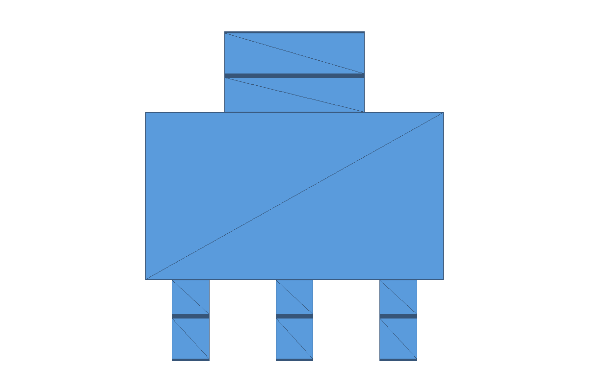
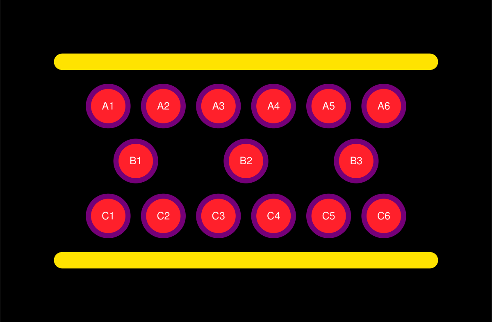

<div align="center">


**从器件图纸与手册，到 STEP 数模、PCB 焊盘与原理图符号。**

<p>


</p>

<p>
<a href="#overview">项目概览</a> ·
<a href="#workflows">三个 Agent</a> ·
<a href="#previews">效果预览</a> ·
<a href="#quickstart">启动指南</a> ·
<a href="#docs">文档导航</a>
</p>

</div>

<a id="overview"></a>

## 🧭 项目概览

**Component Foundry** 是面向电子元器件的多 Agent 工程工作台。上传封装尺寸图、推荐焊盘图或器件手册，分别由 STEP、PCB、Symbol Agent 读取资料、核对参数并生成对应的工程文件。

遇到缺少尺寸、符号绑定不清或引脚位置冲突，任务会询问需要补充的项目。原始资料、人工修订、执行记录和检查点会保留，便于复核结果及继续未完成的任务。

> 读清图纸，核对参数，再生成可复核的工程文件。

- 🧩 **一个工作台，三条工作流**：统一上传、任务历史、参数核对、预览与下载。
- 📐 **尺寸与来源对应**：保留图纸候选、尺寸单位、人工补充和修改记录。
- 👁️ **填写时看见几何**：PCB 修改焊盘坐标、形状和尺寸时同步更新顶视预览。
- 🔁 **任务可恢复**：PostgreSQL 保存状态、人工回答与 LangGraph checkpoint。
- 🖥️ **本机或远端执行**：PCB 和 Symbol 可选择安装了 Cadence 的 Windows 设备。

<a id="workflows"></a>

## 🤖 三个 Agent

| Agent | 输入资料 | 主要工作 | 输出 |
|:--|:--|:--|:--|
| **📐 STEP** | 封装尺寸图、器件工程图 | 视图识别、尺寸证据复核、器件族路由、参数化建模与几何校验 | `.step`、等轴测图和三个正交视图 |
| **🟡 PCB** | 推荐焊盘图、封装尺寸图；可追加辅助图片或 PDF | 逐焊盘核对脚号、位置与铜盘尺寸，生成并检查原生封装 | `.dra`、`.psm`、`.pad`、SVG / PNG 预览及执行日志 |
| **🔌 Symbol** | PDF 手册或封装引脚图 | 提取引脚编号与名称、核对布局，调用 Capture 生成符号 | `.olb`、`.dsn`、Tcl 与执行日志 |

### 📐 STEP · 按图纸建模

已有器件族包括 D-Sub、两侧／四侧鸥翼 IC、QFN、片式电阻和电容；具体图纸仍须通过尺寸证据与几何校验。

两侧鸥翼 IC 按顶视图分为**上侧引脚**和**下侧引脚**，分别记录数量、宽度、脚底长度、金属厚度和首末中心距。支持 3＋1、3＋2 等不同排布；单脚侧的首末中心距为 0。独立设置两侧脚长或厚度时，需要核对两侧参数。

### 🟡 PCB · 边填写，边核对

尺寸确认页面提供逐焊盘编辑、新增／删除、相同宽度批量调整和即时顶视预览。矩形与圆形焊盘均可显示；圆形焊盘按直径填写，两个尺寸轴同步。

图中有明确引脚定义时，脚号按位置核对。缺少推荐焊盘图的任务可结合封装图补充参数；尺寸来源不明确时进入追问，具体生成范围见 [PCB 说明](backend/agents/pcb/README.md)。

### 🔌 Symbol · 从手册到原生符号

PDF 与图片使用各自的读取流程。清晰的引脚图通过自检后可直接生成；PDF 保留引脚核对及生成前确认。任务支持分页历史、可恢复删除、原始资料下载和 checkpoint 回溯。

<a id="previews"></a>

## 👁️ 效果预览

下面是项目实际导出的预览：左侧为 SOT223 的 3＋1 引脚包络模型，右侧为 15 个圆形焊盘的铜箔与阻焊预览。

<table>
<tr>
<td align="center" width="50%">
<a href="docs/step-human-interaction.md"></a>
<p><strong>📐 STEP · 独立两侧引脚</strong><br /><sub>分别核对数量与宽度，输出模型及多视图</sub></p>
</td>
<td align="center" width="50%">
<a href="frontend/pcb/README.md"></a>
<p><strong>🟡 PCB · 圆形焊盘阵列</strong><br /><sub>铜箔、阻焊与脚号按参数生成</sub></p>
</td>
</tr>
</table>

PCB **填写阶段的即时预览**会随表格变化更新；上面的图片是**生成后的产物预览**。STEP 当前在生成模型后显示四个视图，尚未提供填写尺寸时的实时三维预览。包络模型中未完整描述的折弯等细节仍需核对原图。

<a id="stack"></a>

## 🧰 技术栈与执行方式

<div align="center">


</div>

```text
图纸 / 手册 → 识别与证据绑定 → 参数核对 → 生成与校验 → 工程文件 / 预览
                              │
               PostgreSQL：任务状态 · 回答记录 · Checkpoint
```

STEP 在后端执行 CadQuery / OpenCascade。PCB 与 Symbol 调用 Windows 上的 Allegro / Capture，支持本机或 SSH；同一设备共用执行队列。前端由 FastAPI 同源提供，无需额外构建步骤。

<a id="quickstart"></a>

## 🚀 启动指南

### 1. 准备运行环境

- Python 3.11+，以及兼容的 CadQuery / OpenCascade 环境。
- PostgreSQL、项目运行依赖，以及模型服务配置。
- 生成原生 PCB / Symbol 文件时，需要安装相应 Cadence 程序并配置可用许可。

`requirements.txt` 当前是环境版本清单，**不能直接用 `pip install -r requirements.txt` 安装**。依赖准备、初始数据库和账号配置见 [完整安装与 API 指南](docs/getting-started.md)；工作机部署见 [公司试用版部署说明](docs/company-pilot部署说明.md)。Compose 使用已配置的外部数据卷和网络，迁移步骤也在部署说明中。

### 2. 配置本地参数

在项目根目录创建 `.env.local`，填写数据库、JWT 签名密钥及模型服务参数。示例值需要替换为自己的配置：

```dotenv
DB_HOST=localhost
DB_PORT=5433
DB_NAME=agent
DB_USER=your_db_user
DB_PASSWORD=your_db_password
JWT_SECRET_KEY=replace_with_a_long_random_secret

DEEPSEEK_API_KEY=your_deepseek_api_key
DEEPSEEK_BASE_URL=https://api.deepseek.com/v1
DEEPSEEK_MODEL_CHAT=your_chat_model
QWEN_API_KEY=your_qwen_api_key
QWEN_BASE_URL=https://your-qwen-compatible-endpoint/v1
QWEN_MODEL_VL=your_vision_model
```

端口须与实际数据库一致；上例采用当前 Compose 的默认宿主机映射。完整配置项由 [Settings](backend/config.py) 定义，`.env.local` 不随仓库提交。服务没有内置默认账号，请按安装／部署指南初始化账户。

### 3. 启动统一工作台

完成依赖、数据库和账号初始化后，在项目根目录使用准备好的 Python 环境运行：

```powershell
python -s -m backend.main
```

Windows 已配置环境也可使用 `scripts/start_project.ps1`，通过 `-PythonPath` 指定解释器。

| 入口 | 本机地址 |
|:--|:--|
| **统一工程工作台** | <http://127.0.0.1:8000/api/v1/workbench/ui> |
| STEP / PCB / Symbol 独立页面 | `/api/v1/step/ui` · `/api/v1/pcb/ui` · `/api/v1/symbol/ui` |
| 邀请码注册 | `/api/v1/auth/ui` |
| API 文档 | <http://127.0.0.1:8000/docs> |
| 健康 / 数据库就绪检查 | `/health` · `/api/v1/workbench/ready` |

局域网访问时，将 `127.0.0.1` 替换为运行服务的电脑地址。应用唯一入口为 `backend.main`；配置、接口调用与远端执行的完整示例在 [安装与 API 指南](docs/getting-started.md)。

<a id="structure"></a>

## 🗂️ 项目结构

```text
backend/
  agents/step/       图纸解析、器件族模板、CAD 生成与校验
  agents/pcb/        焊盘识别、尺寸核对、Allegro 原生执行
  agents/symbol/     引脚读取、布局、自检、Capture 原生执行
  api/               Agent API、统一工作台、来源附件与设备配置
  core/              模型调用、日志、鉴权与设备队列
  db/                数据库迁移
  main.py            统一应用入口与任务恢复
frontend/            统一工作台、独立页面与共享核对组件
scripts/             启动、初始化、部署及原生执行脚本
tests/               自动化测试与回归样例
docs/                使用说明、部署指南及测试记录
```

<a id="docs"></a>

## 📚 文档导航

| 想了解什么 | 文档 |
|:--|:--|
| 安装、配置、登录和 API 调用 | [安装与 API 指南](docs/getting-started.md) |
| 统一工作台、设备选择及队列 | [工作台说明](frontend/workbench/README.md) |
| STEP 尺寸补充、模型审核及恢复 | [STEP 人工交互](docs/step-human-interaction.md) |
| PCB Agent 与逐焊盘输入 | [PCB Agent](backend/agents/pcb/README.md) · [PCB 页面](frontend/pcb/README.md) |
| Windows 工作机与远端执行 | [工作机部署](docs/workstation-deployment.md) |
| 邀请码、依赖服务、备份与上线验收 | [公司试用版部署](docs/company-pilot部署说明.md) |
| 离线测试、实机回归及已知问题 | [测试指南](docs/testing.md) |

<a id="validation"></a>

## 🧪 验证与当前边界

```powershell
python -s -m pytest -m "not integration"
node --test frontend/tests/*.test.mjs
```

浏览器测试需要 Playwright 与 Chromium；环境准备见测试指南。2026-10-14 的记录：前端 **32 项通过**；后端 **692 项通过、2 项既有失败**，另有 2 项集成测试未运行。失败为 TI 封装参考模型搜索返回 `None`、Golden 样例缺少 ADC 参考图，详情已保留在测试文档。

- STEP 只覆盖已实现且通过证据门禁的器件族，包络模型与精确器件模型须区分。
- 原生 CAD 进程退出时的堆错误仍待修复；几何检查通过不代表运行进程已稳定。
- 本机／SSH Cadence 生成需要实际安装环境和许可；设备“已配置”不等于连接或许可已验证。
- `sample/`、`output/`、`tmp/`、运行缓存与本地凭据不随代码提交。

<div align="center">

---

<sub>Built by <a href="https://github.com/Scott1314866">Scott Cui</a> · 图纸识别 · 参数核对 · 工程生成</sub>

</div>
